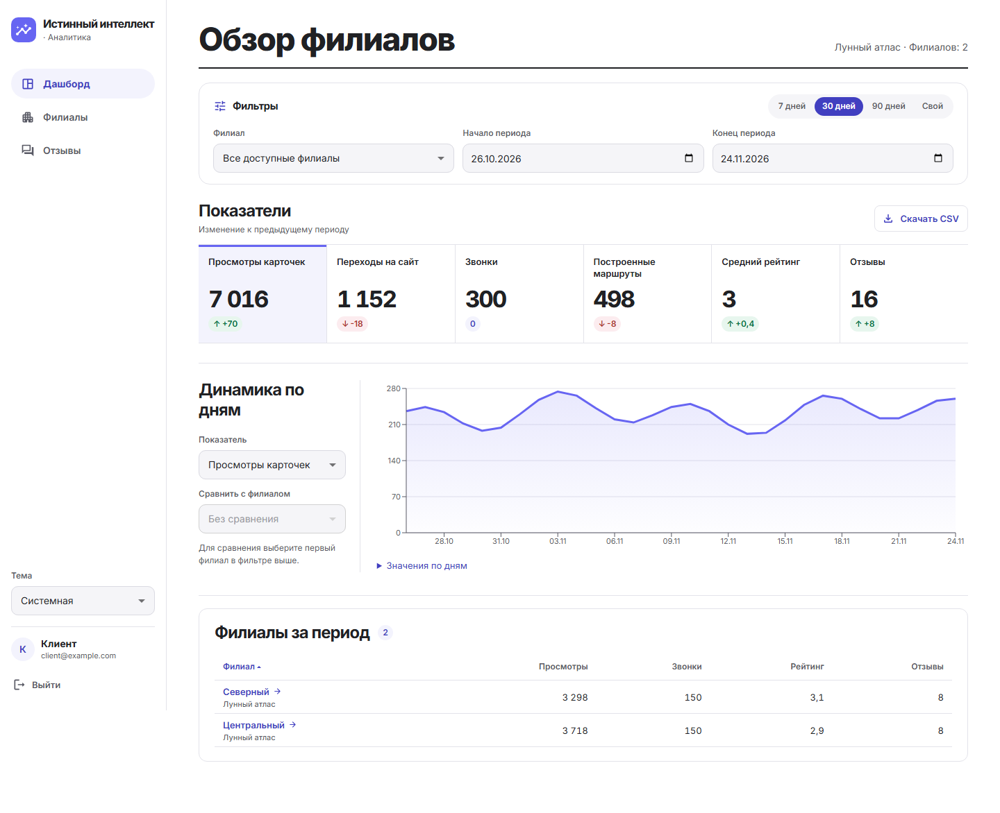

Аналитика

Кабинет показывает просмотры карточек филиалов, переходы на сайт, звонки, построенные маршруты, средний рейтинг и число отзывов. Клиент сравнивает свои филиалы, обрабатывает отзывы и выгружает статистику в CSV. Администратор может выбрать любую компанию и загрузить показатели из учебного HTTP-источника.

Фронтенд написан на React и TypeScript с MUI, сервер — на NestJS и PostgreSQL.

## Материалы по ТЗ

[Полное ТЗ](TASK.md) · [Девять скриншотов](docs/screenshots/README.md) · [Сценарии проверки](docs/task-audit.md) · [Схемы C1–C4](docs/architecture/README.md) · [Архитектурные решения](DECISIONS.md)

## Запуск

Для запуска нужны Git, Docker с Compose v2 и GNU Make. Склонируйте проект и запустите его из корня репозитория.

```sh
git clone https://github.com/Nastoiker/geo-atlas.git
cd geo-atlas
make
```

На первом запуске Compose соберёт приложение, применит миграции и заполнит пустую базу демоданными. Последней строкой `make` выведет адрес веб-сервера. [Открыть кабинет на порту 5173](http://localhost:5173)

| Роль | Логин | Пароль демостенда |
| --- | --- | --- |
| Клиент | `client@example.com` | `Demo-Atlas-42` |
| Администратор | `admin@example.com` | `Demo-Atlas-42` |

`make up` запускает тот же стенд, `make logs` показывает журналы в реальном времени, `make down` останавливает сервисы и сохраняет базу. Если GNU Make не установлен, используйте `docker compose up --build -d --wait` для запуска и `docker compose down` для остановки.



## Проверки

Для проверок нужен Node.js 22 с npm. Из свежего клона выполните две команды.

```sh
make check
make smoke
```

`make check` устанавливает зависимости, готовит Prisma и Chromium, поднимает отдельную тестовую PostgreSQL и запускает сценарий `check` из package.json. Он проверяет типы, сборку, ESLint, Prettier, тесты API, компонентов и браузера. `make smoke` обращается к запущенному кабинету по HTTP и сверяет результат импорта с БД. В минимальном Linux системные библиотеки Chromium можно установить через `npx playwright install --with-deps chromium` после `npm ci`.

<details>
<summary>Команды проверок без Make</summary>

```sh
npm ci
npx prisma generate
npx playwright install chromium
docker compose --profile test up --build -d --wait
npm run check
node scripts/smoke.js
```

</details>

После `check` команда `npm run mutations` поочерёдно вносит семь изменений в локальную сборку, ожидает падения соответствующего теста и восстанавливает файл.

При изменении интерфейса пересоберите стенд командой `make`, затем выполните `npm run screenshots`. Добавьте изменившиеся PNG из `docs/screenshots` в тот же коммит, что и код интерфейса.

### Свежий клон рядом с запущенным стендом

Чтобы запустить второй экземпляр, создайте в корне второго клона файл `.env` с отдельным именем проекта и свободными портами.

```dotenv
COMPOSE_PROJECT_NAME=geo-atlas-review
WEB_PORT=15173
TEST_DB_PORT=55449
```

В этом клоне используйте те же команды `make`, `make check`, `make smoke` и `make down`. Для отдельного прогона мутационных тестов с портами из этого файла выполните `node --env-file=.env --run mutations`. [Открыть второй кабинет](http://127.0.0.1:15173)

## Архитектура

Node.js исполняет серверную сборку, скрипты и конфигурацию как ES-модули. JavaScript-файлы используют расширение `.js`.

| Путь | Ответственность |
|---|---|
| `apps/api/src/modules` | Домены `auth`, `branches`, `companies`, `metrics`, `reviews`, `imports`. В каждом домене есть `*.module.ts`, `*.controller.ts`, `*.service.ts` и `*.repository.ts` |
| `apps/api/src/common/access-scope.ts` | SQL-предикат видимости. Его используют запросы отчёта, списка, CSV и отзывов |
| `apps/api/src/common` | Настройки, подключение к PostgreSQL, общие DTO и обработка ошибок |
| `apps/web/src/app`, `pages` | Провайдеры React и MUI, маршруты и страницы входа, дашборда, филиалов и отзывов |
| `apps/web/src/widgets` | Навигация, отчёт с карточками, графиком и таблицей, раздел отзывов |
| `apps/web/src/features` | Вход и выход, фильтры в URL, импорт, экспорт, смена статуса и темы |
| `apps/web/src/entities`, `shared` | Контракты данных, запросы и ключи кеша по сущностям. Общий HTTP-клиент находится в `shared/api` |
| `prisma`, `scripts`, `e2e` | Схема и миграции, генераторы демоданных, замеры PostgreSQL, API- и браузерные проверки |

Внутри слайса `ui` отображает состояние, `model` управляет запросами, `lib` содержит вычисления. Соседние слайсы одного слоя независимы. Слои приложения обращаются к нижележащим слайсам через их `index.ts`. Границы импортов проверяет ESLint.

У компании есть пользователи и филиалы. У филиала есть daily_metrics, reviews и import_runs. Таблица login_windows хранит хеш логина, число занятых попыток и срок окна. Составной первичный ключ daily_metrics задаёт одну запись на филиал и день. Индекс reviews начинается с филиала и включает оценку и статус. Внешние ключи, диапазон рейтинга и неотрицательные значения метрик проверяются базой.

Запрос проходит через глобальный guard, DTO и контроллер домена. Веб-контейнер отдаёт статическую сборку Vite через Nginx и проксирует /api в Nest. Сервис определяет сценарий, репозиторий выполняет параметризованный SQL через Prisma. AccessScope собирает единый SQL-предикат компании и, если выбран, филиала. Для клиента идентификатор компании берётся из подписанного JWT. Администратор может сузить выборку фильтром company. Каждый запрос отчёта и отзывов применяет этот подзапрос непосредственно в SQL. Дневные показатели и отзывы объединяются перед группировкой. PostgreSQL считает общий итог, точки по дням и строки по филиалам через GROUPING SETS в одном запросе на текущий период. Предыдущий период и CSV используют ROLLUP по дате. Число запросов к БД для таблицы не зависит от числа филиалов.

Даты и фильтры сохраняются в URL. Для сравнения на графике выберите первый филиал в фильтре, второй — в поле «Сравнить с филиалом». Экспорт CSV использует ту же выборку доступных филиалов и те же дневные показатели, что и дашборд.

## Защита входа

На нормализованный логин даётся пять неудачных попыток в одном десятиминутном окне. Короткое имя, e-mail и регистр приводятся к одному ключу. PostgreSQL резервирует попытку до проверки пароля, успешный вход освобождает своё место. Шестой запрос в заполненном окне получает 429 и Retry-After в секундах. Окна общие для экземпляров API, истёкшие записи удаляются при следующем входе. Ограничение по IP для публичного размещения можно настроить на входном прокси.

## Отзывы

В кабинете откройте «Отзывы». Филиал и период сохраняются при переключении разделов. У отзыва можно изменить статус, а список можно сузить по оценке и статусу. Клиент обрабатывает отзывы своих филиалов, администратор — любой компании.

`GET /api/reviews` принимает также rating, status, limit (1–100, по умолчанию 20) и cursor. Ответ содержит массив. Когда есть следующая страница, сервер передаёт идентификатор последней строки в заголовке X-Next-Cursor. Сортировка идёт по убыванию времени и по возрастанию id при одинаковом времени. `PATCH /api/reviews/:id` принимает поле status со значением new, in_progress или resolved.

## Допущения

Границы периода включены, максимальная длина 366 дней, даты стенда в UTC. Предыдущий период заканчивается накануне текущего и имеет ту же длину. Разница показана в единицах карточки. При отсутствии оценок отображается прочерк. Для клиента доступна одна компания. Для администратора выбор компании работает как фильтр отчёта. Основная спецификация разрешает выбор дополнительного задания, реализованы варианты А и Б.

Сид создаёт две вымышленные компании, четыре филиала, двух пользователей, 120 дней статистики и 48 отзывов. Для совместимости формы входа короткие имена admin и client также работают. Учебный источник возвращает снимок дневных значений и иногда повторяет день. При нескольких версиях одного дня в одном ответе сохраняется последняя.

## Известные ограничения

Запуск рассчитан на локальную демонстрацию. Для публичного сервиса понадобятся HTTPS, постоянный JWT_SECRET, защищённая cookie и защита периметра. Настройки перечислены в .env.example. В отсутствие секрета API генерирует ключ на время процесса. Демосид привязан к дате первого запуска. Миграция рассчитана на новую базу, прежний стенд Knex требует отдельного переноса данных. Импорт выполняется синхронно. При аварийном завершении процесса запись журнала может остаться running.

## Измерение на 500 филиалах

Команда `npm run seed:perf` запускает выделенную PostgreSQL 16 и идемпотентно создаёт 50 компаний по десять филиалов, 60 000 дневных снимков и 60 000 отзывов. Данные лежат в отдельном томе `geo-perf`. Команда `npm run perf` повторяет сид и выполняет EXPLAIN (ANALYZE, BUFFERS, FORMAT JSON) до и после построения индекса в этой базе. Используются те же SQL-функции, что обслуживают API. Чтобы получить также полные деревья узлов PostgreSQL в формате JSON, выполните `npm run perf -- --plans`. Для остановки нагрузочной БД выполните `docker compose --profile perf stop perf-db`.

Замер от 24 ноября 2026 года в Docker Desktop. В таблице медиана семи исполнений после одного прогрева. Блоки — сумма shared hit и shared read корневого узла. Время относится к исполнению запроса PostgreSQL, без HTTP и планирования. Период — апрель 2026 года.

| Запрос | До, мс | После, мс | Блоки до → после |
|---|---:|---:|---:|
| Справочник 10 филиалов одной компании | 0,017 | 0,016 | 4 → 4 |
| Отчёт компании за 30 дней с разбивкой по филиалам | 0,900 | 0,544 | 1542 → 653 |
| Страница из пяти отзывов одного филиала | 0,086 | 0,024 | 124 → 11 |
| Отзывы компании с оценкой 4 и статусом «Новый» | 0,099 | 0,104 | 104 → 104 |

По этим планам добавлен индекс `reviews(branch_id, created_at DESC, id ASC)`. Запрос страницы читает первые записи нужного филиала в порядке выдачи, а отчёт ограничивает диапазон дат внутри филиала. При одновременном фильтре оценки и статуса планировщик выбрал имеющийся индекс `(branch_id, rating, status)`. Первичный ключ `daily_metrics(branch_id, date)` обслуживает историю показателей.

## Масштабирование до 500+ компаний и тысяч филиалов

Сначала измерить планы отчётов через EXPLAIN ANALYZE. При росте истории разделить daily_metrics по месяцам, сохранив индекс по филиалу и дате. Для частых длинных периодов хранить дневные и месячные агрегаты с суммой оценок и числом отзывов. Ключ кеша отчёта должен включать область доступа, филиал и даты. Инвалидировать затронутые периоды после успешного импорта.

Перенести импорт в очередь с лимитом запросов на источник и повторным подбором зависших задач. Ограничить пул соединений, использовать PgBouncer и отправлять тяжёлые отчёты на реплику с учётом задержки. Добавить PostgreSQL Row Level Security как независимый уровень изоляции.
