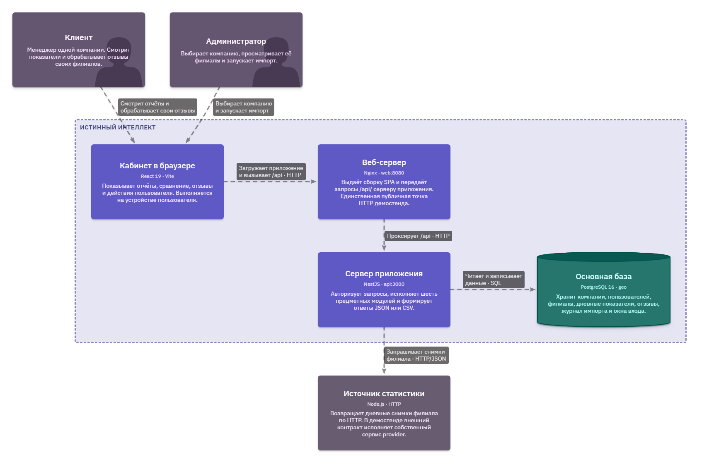

# Как устроен кабинет «Истинный интеллект»

Кабинет показывает, что происходило с филиалами компании за выбранные даты. Браузер показывает отчёт, NestJS определяет доступные филиалы, PostgreSQL считает показатели. Внешний источник участвует только при импорте.

**Если есть пять минут**, откройте три схемы по порядку. На первой проследите стрелки от клиента до базы. На второй найдите «Метрики и CSV». На третьей дойдите от `MetricsController.get` до `reportSql`. [C2 · Контейнеры](map/index.html#/view/containers/) → [C3 · Сервер](map/index.html#/view/backend/) → [C4 · Расчёт показателей](map/index.html#/view/metricsCode/)

Те же три схемы можно посмотреть в репозитории как изображения. [Контейнеры](containers.png) · [Компоненты сервера](backend.png) · [Код расчёта](metrics.png)

Карта открывается с диска двойным щелчком по `map/index.html`. Для просмотра достаточно браузера. На карточке с вложенной схемой наведите курсор и нажмите **Navigate to view**. Кнопка **Open details** открывает описание и ссылку «Открыть исходник». [Открыть карту с первого уровня](map/index.html)

## Четыре уровня

| Уровень | Что можно выяснить | Куда перейти |
| --- | --- | --- |
| C1 · Контекст | Кто пользуется кабинетом и кто поставляет показатели | [Люди и система](map/index.html#/view/index/) |
| C2 · Контейнеры | Где исполняется код и какие процессы обмениваются данными | [Браузер, Nginx, API, база и источник](map/index.html#/view/containers/) |
| C3 · Компоненты | Кто внутри контейнера отвечает за конкретную работу | [Браузер](map/index.html#/view/frontend/) · [Сервер](map/index.html#/view/backend/) · [Nginx](map/index.html#/view/gateway/) |
| C4 · Код | Какие классы, функции и React-хуки выполняют работу | [Отчёт в браузере](map/index.html#/view/reportCode/) · [Расчёт в API](map/index.html#/view/metricsCode/) |

Стрелка показывает, кто вызывает следующий блок. Цвет выделяет тип элемента, цилиндр обозначает хранилище. На схеме таблиц стрелка ведёт от внешнего ключа к родительской таблице. [Обозначения уровней C4 у Саймона Брауна](https://c4model.com/diagrams)

## C2 · Что запущено



| Элемент | Где находится | За что отвечает |
| --- | --- | --- |
| React | Браузер пользователя | Хранит фильтры в URL, загружает JSON, рисует шесть карточек, график и таблицу |
| Nginx | `web:8080`, с компьютера `127.0.0.1:5173` по умолчанию | Отдаёт собранный фронтенд, передаёт `/api/` в NestJS |
| NestJS | `api:3000` | Проверяет сессию и права, читает и изменяет данные |
| PostgreSQL 16 | `db:5432`, база `geo` | Хранит семь таблиц. При старте API применяет миграции и запускает заполнение демоданных |
| Источник статистики | В демостенде `provider:3100` | Отдаёт дневные снимки по HTTP. Адрес задаёт `PROVIDER_URL` |

Обычный запуск Compose поднимает четыре сервиса. React скачивается из `web` и исполняется на устройстве пользователя. В профиле `test` есть отдельная база `test-db`, в профиле `perf` запускаются `perf-db` и `benchmark`. [Docker Compose](../../docker-compose.yml) · [Сборка и запуск](../../Dockerfile) · [Конфигурация Nginx](../../apps/web/nginx.conf)

## C3 и C4 · Где искать код

У всех маршрутов в таблице общий префикс `/api`. В одном процессе NestJS шесть предметных модулей. До вызова контроллера глобальный `SessionGuard` извлекает пользователя из подписанной cookie. Маршрут входа помечен публичным. [Сборка модулей](../../apps/api/src/app.module.ts) · [C4 · Обработка HTTP и сессия](map/index.html#/view/httpCode/)

| Модуль | Маршруты | С чего начать |
| --- | --- | --- |
| Auth | `POST /login`, `GET /me`, `POST /logout` | Пароль, окно попыток и выдача сессии. [Схема](map/index.html#/view/authCode/) · [AuthService](../../apps/api/src/modules/auth/auth.service.ts) |
| Companies | `GET /companies` | Клиент получает собственную компанию, администратор видит список. [Схема](map/index.html#/view/companiesCode/) · [CompaniesRepository](../../apps/api/src/modules/companies/companies.repository.ts) |
| Branches | `GET /branches`, `GET /branches/:id` | Область компании и выбор доступных филиалов. [Схема](map/index.html#/view/branchesCode/) · [Selection](../../apps/api/src/modules/branches/selection.service.ts) |
| Metrics | `GET /dashboard`, `GET /export` | Общая выборка для экрана и CSV. [Схема](map/index.html#/view/metricsCode/) · [MetricsRepository](../../apps/api/src/modules/metrics/metrics.repository.ts) |
| Reviews | `GET /reviews`, `PATCH /reviews/:id` | Рейтинг, статус, курсор и изменение записи. [Схема](map/index.html#/view/reviewsCode/) · [ReviewsRepository](../../apps/api/src/modules/reviews/reviews.repository.ts) |
| Imports | `POST /imports` | Импорт одного филиала за период, доступен администратору. [Схема](map/index.html#/view/importsCode/) · [ImportsService](../../apps/api/src/modules/imports/imports.service.ts) |

Во фронтенде `app` подключает роутер и провайдеры. Страницы собирают виджеты, действия пользователя находятся в `features`, запросы и контракты данных — в `entities`, общий HTTP-клиент — в `shared`. Найдите свой вопрос в таблице, чтобы открыть соответствующие хуки и компоненты.

| Что нужно понять | Схемы C4 браузера |
| --- | --- |
| Как URL открывает раздел и сохраняет период или филиал | [Маршруты и страницы](map/index.html#/view/routesCode/) · [Фильтры и справочники](map/index.html#/view/workspaceCode/) |
| Откуда карточки, вторая линия на графике и строки отзывов | [Отчёт и сравнение](map/index.html#/view/reportCode/) · [Список и статус отзывов](map/index.html#/view/feedbackCode/) |
| Где начинается запрос, проверяется ответ и обновляется кеш | [Вход, выход, экспорт и импорт](map/index.html#/view/actionsCode/) · [Запросы и кеш](map/index.html#/view/queryCode/) |

## Три запроса от начала до конца

1. **Вход.** `AuthService` резервирует попытку в `login_windows` перед проверкой пароля. При успехе сервис подписывает JWT и освобождает попытку, контроллер отправляет cookie `session` на восемь часов. Следующий `GET /api/me` возвращает пользователя. [Сценарий входа](map/index.html#/view/loginFlow/) · [Проверка сессии](../../apps/api/src/common/session.guard.ts)
2. **Дашборд.** `useReportFilters` читает филиал и даты из URL. Виджет `Report` вызывает `useDashboard`, а сервер получает у `Selection.ids` SQL-подзапрос видимых филиалов. Две параллельные выборки считают текущий и предыдущий равные периоды. Счётчики приходят из `daily_metrics`, рейтинг и число отзывов — из `reviews`. Ответ содержит `metrics`, `previous`, `days` и `branches`. Для сравнения двух филиалов график отправляет второй запрос на тот же маршрут. [Сценарий отчёта](map/index.html#/view/dashboardFlow/) · [Виджет](../../apps/web/src/widgets/analytics/ui/report.tsx) · [Сервис](../../apps/api/src/modules/metrics/metrics.service.ts)
3. **Импорт.** После проверки роли и филиала API создаёт запись `running`, запрашивает источник и сверяет филиал и даты в каждой строке. При повторе даты берёт последний снимок. Обновление дней и статус `success` фиксирует одна транзакция. При сбое сервис записывает `failed` и причину. [Сценарий импорта](map/index.html#/view/importFlow/) · [Чтение источника](../../apps/api/src/modules/imports/import-source.ts) · [Транзакция](../../apps/api/src/modules/imports/imports.repository.ts)

**Почему «Все филиалы» безопасны для клиента?** `AccessScope.predicate` берёт компанию из проверенной сессии. При пустом `branchId` условие компании сохраняется. Этот SQL ограничивает отчёт, CSV и чтение отзывов. При смене статуса отзыва ограничение входит прямо в `UPDATE`. [Условие доступа](../../apps/api/src/common/access-scope.ts) · [Тесты изоляции компаний](../../scripts/tenant-permissions.test.js)

**Как связаны таблицы?** `companies` объединяет `users` и `branches`. К филиалу привязаны `daily_metrics`, `reviews` и `import_runs`. Пара «филиал, дата» уникальна для дневного снимка. У `login_windows` самостоятельный ключ от нормализованного логина. [Схема данных](map/index.html#/view/schema/) · [Модели Prisma](../../prisma/schema.prisma) · [Почему выбраны такие решения](../../DECISIONS.md)

## Как обновить карту

Измените описание в LikeC4 и пересоберите карту из корня репозитория. Для сборки нужны Node.js 24, зависимости проекта и Chromium для Playwright. [Элементы и ссылки на код](model/model.c4) · [Связи](model/relationships.c4) · [Представления](model/views.c4) · [Сценарии](model/scenarios.c4) · [Документация CLI LikeC4](https://likec4.dev/tooling/cli/)

```sh
npm ci
npx playwright install chromium
npx --yes likec4@1.61.1 validate docs/architecture/model --max-warnings 0
npx --yes likec4@1.61.1 build docs/architecture/model --output-single-file --no-build-webcomponent --use-hash-history --base ./ --theme light --title "Истинный интеллект · Архитектура" -o node_modules/.cache/atlas-c4
node docs/architecture/package-map.js node_modules/.cache/atlas-c4
```

Последняя команда сохраняет автономный HTML с относительными ссылками на код и обновляет три изображения для быстрого просмотра.
