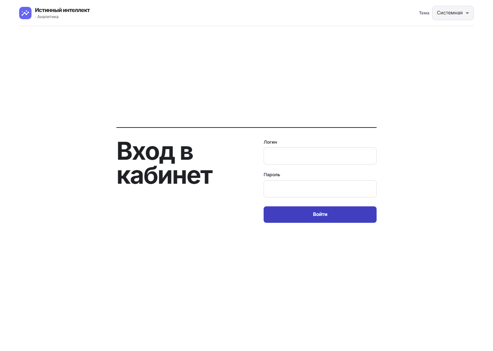
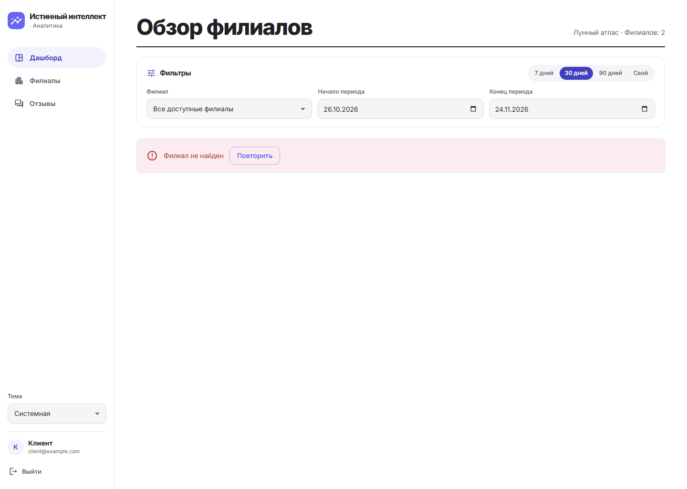
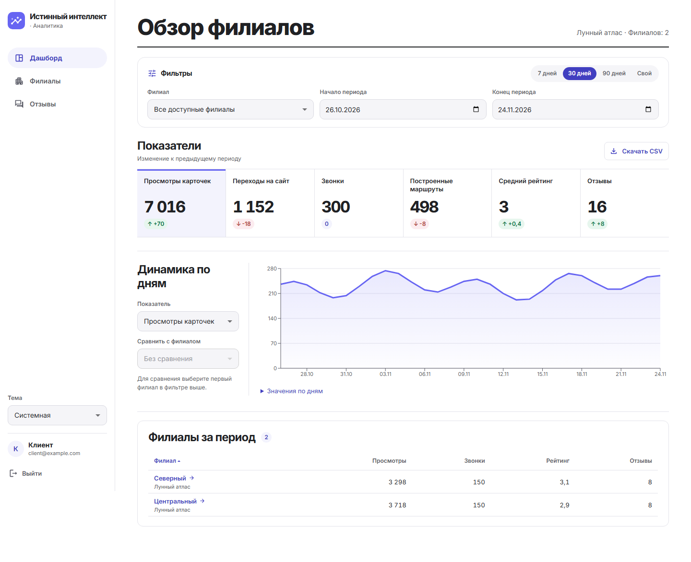
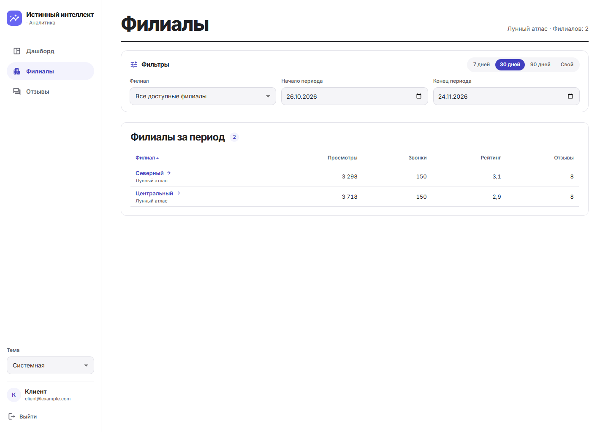
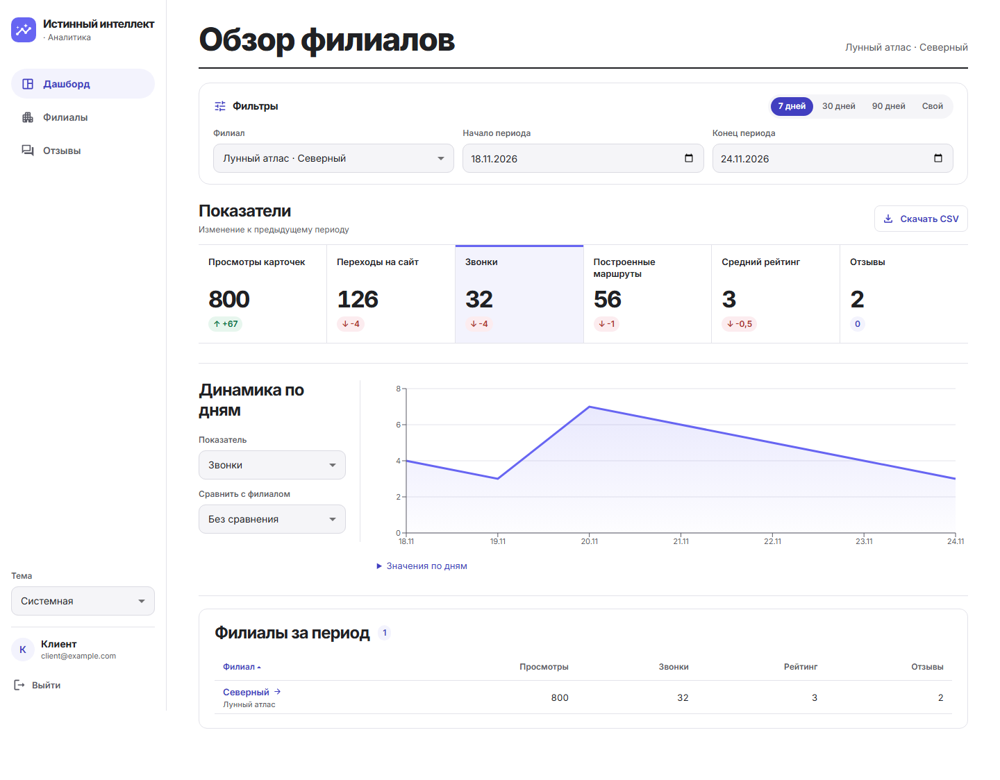
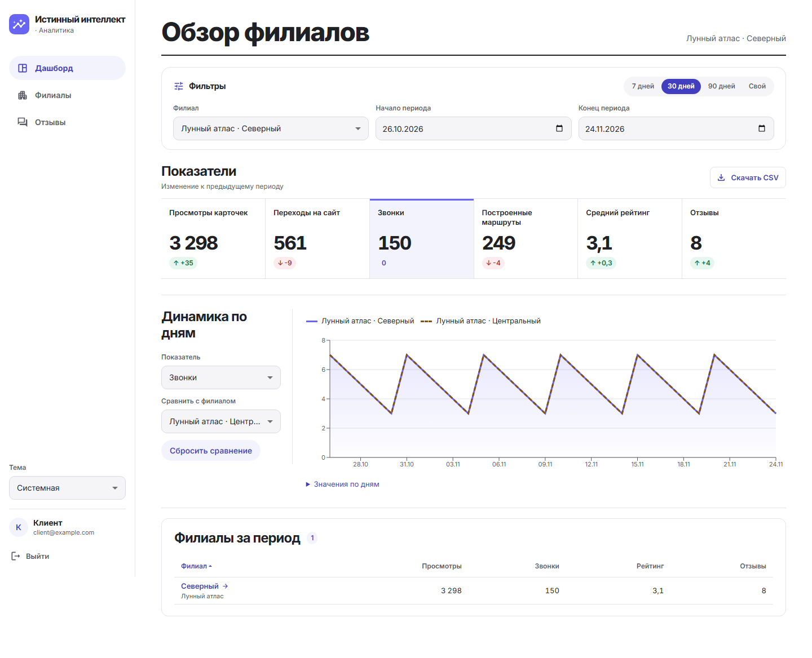
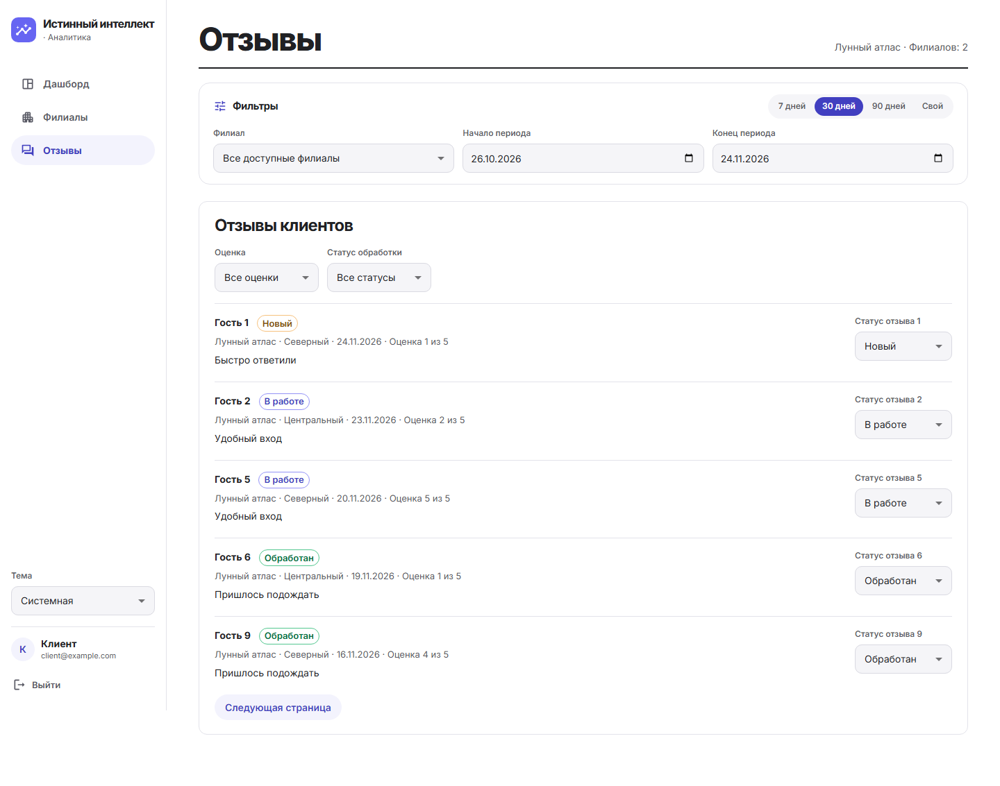
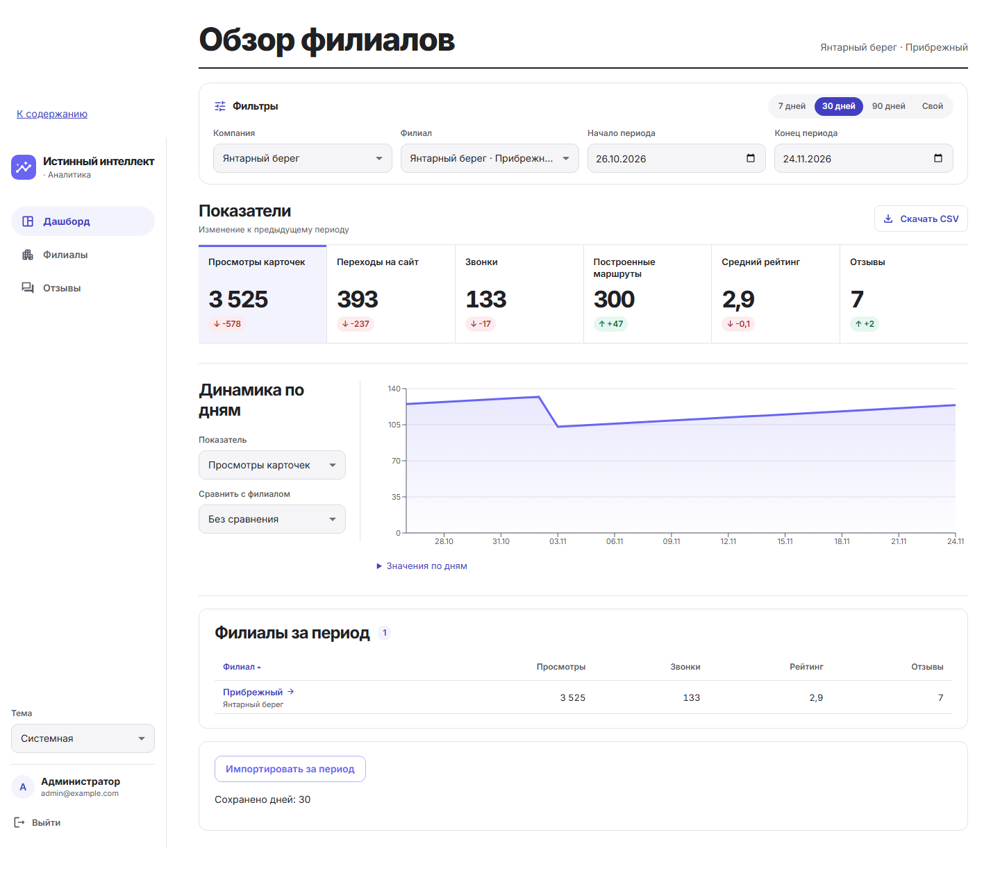
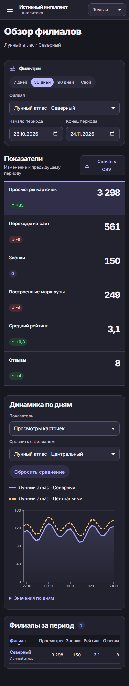

# Скриншоты кабинета

Девять снимков сделаны в Chromium на вымышленных данных демостенда. Чтобы повторить сценарии вручную, используйте учётные записи клиента и администратора. [Запуск и демологины](../../README.md#запуск) · [Исходное ТЗ](../../TASK.md)

## 1. Вход и права доступа

Клиент и администратор входят через одну форму. Доступ к компаниям и филиалам определяет сервер.

При переходе по прямой ссылке на чужой филиал клиент видит сообщение об ограничении доступа.

## 2. Дашборд

Нажмите на один из шести показателей, чтобы увидеть его динамику по дням. Фиолетовая линия отмечает выбранный показатель. Число под итогом показывает изменение относительно предыдущего периода.

## 3. Филиалы

В таблице можно отсортировать филиалы и перейти к статистике выбранного филиала.

В отчёте одного филиала выбран показатель «Звонки» за семь дней.

Второй филиал можно добавить на тот же график. Цвет и штрих линии помогают различать ряды.

## 4. API и база данных

Филиалы, показатели и отзывы на снимках загружены из PostgreSQL через REST API. [Схема Prisma](../../prisma/schema.prisma) · [Сценарии проверки](../task-audit.md)

## 5. Дополнительные задания

**Вариант А.** Клиент фильтрует отзывы по рейтингу и статусу, открывает следующую страницу и меняет статус отзыва.

**Вариант Б.** Администратор выбирает филиал и период для загрузки показателей из учебного источника. После импорта кабинет показывает число сохранённых дней.

## Мобильная версия

На экране шириной 375 пикселей сохраняются фильтры, сравнение филиалов и выбранная тёмная тема.

